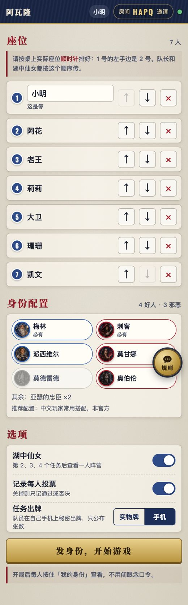
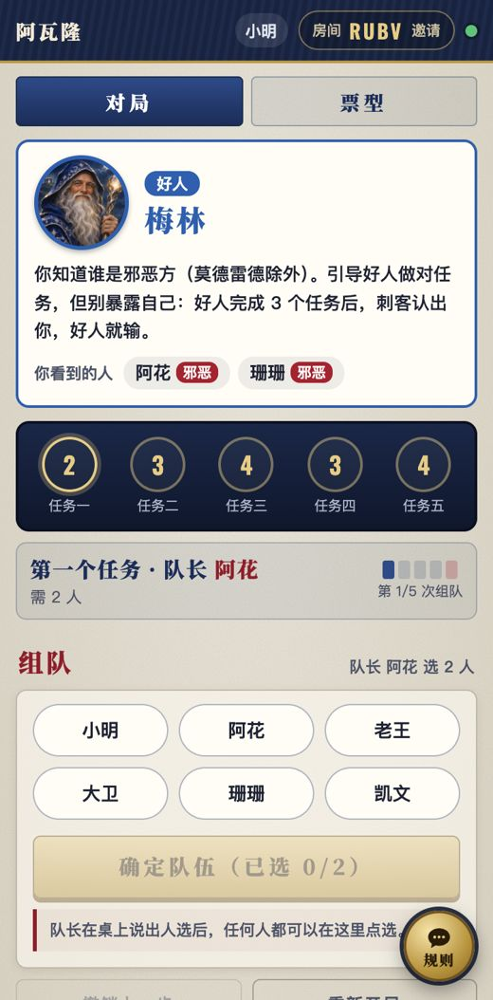
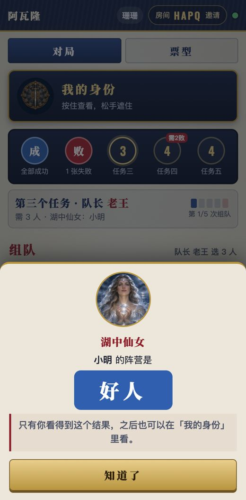
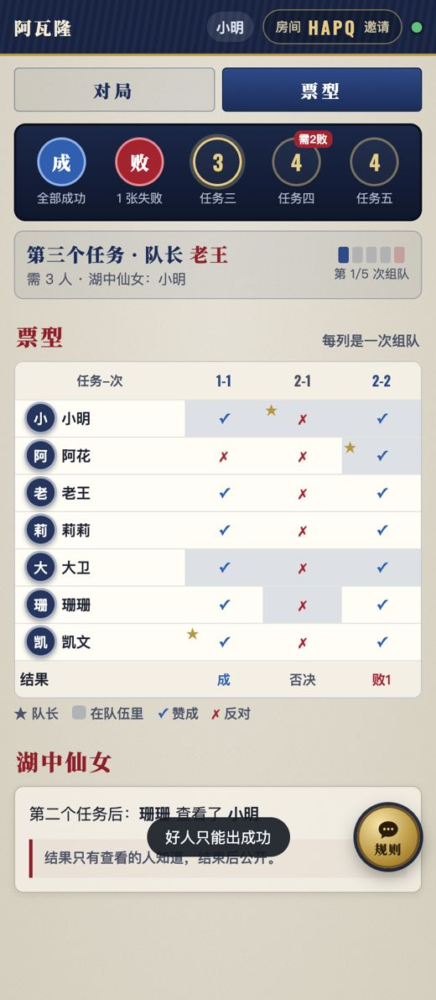
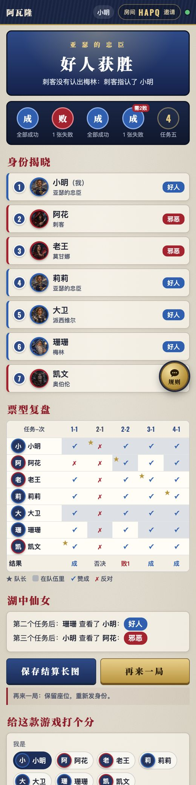
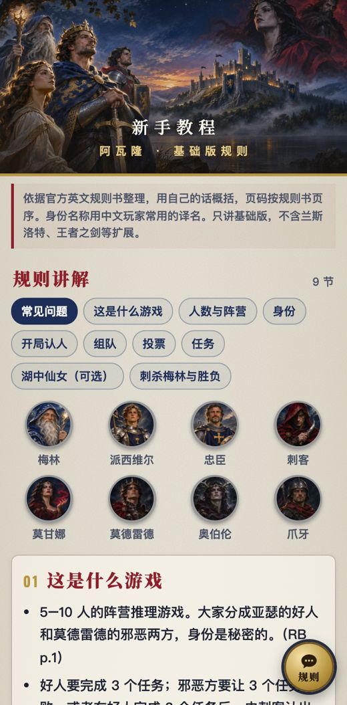
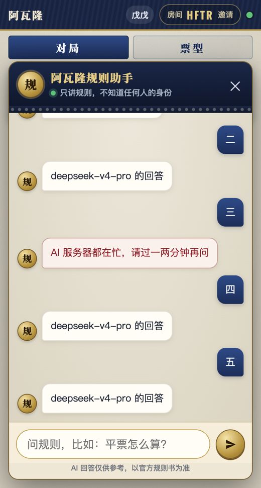

<div align="center">

# 阿瓦隆面杀助手

**手机看身份，票型不再忘**

《阿瓦隆》（The Resistance: Avalon）线下面杀的辅助工具。每人用自己的手机看身份，不用闭眼念口令；组队、投票、任务结果自动记录，湖中仙女和刺杀都在手机上完成。

一桌人扫码或点链接进同一个房间，无需下载、无需注册。只做线下辅助，不能在线玩。


</div>

---

## 做了什么、为什么

开发前调研了 BGG 论坛（阿瓦隆与抵抗组织共 1300 多个主题）、B 站视频与热评、App Store 评论、公众号文章和 GitHub 上的自制工具。原则是：线下用实物更方便的留在线下，需要记录、繁琐、容易出错的才上线。

| 上线 | 依据 |
|---|---|
| 每人手机看身份和夜间信息，省掉闭眼环节 | BGG 点赞最高的文件就是开局口令录音；论坛里有多起因念错口令、看错拇指而重发身份的例子；B 站主持词视频合计约 36 万播放 |
| 组队与投票记录（票型表） | BGG 有 6 份玩家自制记录表；B 站热评“前面的完全忘了” |
| 局面条：任务人数、第 4 个任务要 2 张失败、第几次组队 | 这几条规则在论坛里反复被问 |
| 湖中仙女、刺杀在手机上完成 | 查验结果只给持有人看；刺客自己提交，全桌同时揭晓 |

| 留在线下 | 原因 |
|---|---|
| 组队投票 | 同时亮牌是核心仪式，手机只事后记一笔 |
| 讨论 | 当面讨论是这个游戏的乐趣所在 |
| 任务牌（默认） | 洗牌翻开有仪式感；没带牌时可以改成手机出牌 |

不做：AI 推理或可疑度提示（社区明确反感）、闭眼口令语音、兰斯洛特和王者之剑等扩展。

## 功能一览

### 入座与配置

每人用自己的手机入座，按桌上实际座位顺时针排好，队长和湖中仙女都按这个顺序传。按人数给出推荐配置（中文玩家常用搭配，页面上注明“非官方”），可以增减派西维尔、莫甘娜、莫德雷德、奥伯伦。网站会检查好坏人数，并执行规则书的限制：5 人局带派西维尔时，必须加莫甘娜或莫德雷德。选项有：湖中仙女、是否记录每人投票、任务出牌用实物牌还是手机。

<p></p>

### 按住看身份

开局后按住「我的身份」，就能看到自己的身份，以及按规则能看到的人；松手就遮住。

| 身份 | 能看到 |
|---|---|
| 梅林 | 除莫德雷德外的邪恶方，包括奥伯伦 |
| 派西维尔 | 梅林和莫甘娜，分不清谁是谁 |
| 邪恶同伴 | 彼此，奥伯伦除外 |
| 奥伯伦 | 谁也看不到 |

这些信息由服务器按连接身份过滤，每部手机只收到自己的那一份。

<p></p>

### 组队、投票、任务

- **组队**：队长在桌上说出人选，任何人都可以在手机上点选队员。
- **投票**：大家亮牌后逐个点赞成或反对，网站自动判定，平票算否决。第 5 次组队时会醒目提示“再否决，邪恶方直接获胜”。
- **任务（实物牌）**：翻开后记录失败张数。
- **任务（手机出牌）**：队员在自己手机上秘密出牌。好人只能出成功；服务器只保留成功和失败各几张，不记录是谁出的。
- **撤销**：记错了可以撤销上一步。但发身份、手机出牌、湖中仙女查验、刺杀这几步都会让某人看到秘密信息，所以不能撤销。

### 湖中仙女与刺杀

- **湖中仙女**：持有人在自己手机上选人，结果只显示在他的手机上，令牌自动交给被查的人。不能查自己，也不能查用过湖中仙女的人。
- **刺杀**：好人完成 3 个任务后，刺客在自己手机上指认梅林。

<p> </p>

### 结算与复盘

公开所有身份，附上完整的票型表和湖中仙女记录，可以一键保存长图，也可以「再来一局」（保留座位、重新发身份）。结算页有「给这款游戏打个分」评价卡，评价提交到桌游小助手总入口的统一接口（`game: "avalon"`）。每局结束自动存进往期对局，可以按玩家名、身份或房间码搜索。

<p></p>

### 新手教程、常见问题、规则助手

- **新手教程**：9 节图文讲解。
- **常见问题**：28 条，每条附来源（规则书页码或出版社在 BGG 的答复）。
- **规则助手**：每个页面右下角都有「规则」按钮。
  - **模型**：依次尝试 DeepSeek V4.1 Flash、Workers AI 的 Qwen3.8 27B（`@cf/qwen/qwen3.8-27b`）、DeepSeek V4 Pro。每个模型 9 秒内须开始回答，中途停顿超过 8 秒就换下一个模型从头回答。
  - **定时检查**：每小时检查一次 DeepSeek，不通时，下一小时先用 Qwen。
  - **页面显示**：回答下方不显示是哪个模型答的。
  - **不会泄露身份**：请求只带对话内容，不带任何房间信息，所以助手不可能知道、也不会透露任何人的身份。

<p> </p>

---

## 隐藏信息怎么保证

- **服务器握有全部信息**：完整对局状态只存在服务器（Durable Object）里，判定也只在服务器上做（`public/logic.js` 的 `reduce()`）。
- **按连接分发**：手机入座时拿到一个私密座位令牌（存在本机 localStorage）。之后的每次连接，服务器都按令牌认出座位，只发两种内容之一：
  - 给入座的手机：`seatView(state, 座位)`，即公开信息，加上自己的身份、能看到的人、自己的湖中仙女结果、自己刚出的任务牌。
  - 给没入座的手机：`publicView(state)`。
- **游戏结束后才公开**：所有身份结束后才放进公开视图。
- **手机出牌不留痕**：所有队员出完后，服务器只存失败张数，谁出了什么当场丢弃。
- **测试**：
  - `tests/test_leak.mjs`：用真实 WebSocket，对 5–10 人、两种出牌方式、有无湖中仙女各打一整局，逐帧检查每部手机收到的内容。
  - `tests/test_logic.mjs`：在 2,500 多局随机对局里，检查每个状态的每个视图。

## 技术实现

纯前端页面 + Cloudflare Workers，没有构建步骤，没有框架。

| 部分 | 说明 |
|---|---|
| `public/logic.js` | 规则表、身份视野、`reduce()` 权威判定、`publicView()` / `seatView()` 视图过滤 |
| `src/worker.js` | 建房接口；`Room`（每个房间一个 Durable Object，按连接身份分发视图）；`Lobby`（首页房间列表，只含玩家名和进度）；`Archive`（往期对局）；`/api/chat` 规则助手（备用模型切换、按 IP 限流、每小时检查 DeepSeek，结果存 KV） |
| `public/app.js`、`chat.js`、`style.css` | 页面；视觉沿用「桌游小助手」系列的组件，配色改为深蓝、银、红、金 |
| `tools/` | 讲解稿、常见问题、教程页生成脚本 |
| `tests/` | 规则单元测试、隐藏信息泄露测试、多手机端到端测试、评价卡测试、规则助手测试 |

## 本地开发与测试

需要 Node.js、[Wrangler](https://developers.cloudflare.com/workers/wrangler/)、本机 Chrome 和 `playwright-core`。

```bash
wrangler dev --port 8861 --test-scheduled --var DEEPSEEK_API_KEY:fake --var DEEPSEEK_BASE:http://127.0.0.1:8862 --var CHAT_CF_MODEL:@cf/none/missing
```

```bash
node tests/test_logic.mjs                                            # 规则与视图（不需要服务器）
node tests/test_leak.mjs   http://localhost:8861/                    # 隐藏信息不泄露：12 种桌型各打一整局
node tests/test_game.mjs   http://localhost:8861/ ./shots            # 7 部手机完整一局 + 5 次否决 + 撤销
node tests/test_review.mjs http://localhost:8861/ ./shots            # 评价卡（拦截总入口接口，不写线上数据）
node tests/test_chat.mjs   http://localhost:8861/ ./shots            # 规则助手：备用模型切换、定时检查、不带房间信息
node tests/test_chat.mjs   https://你的域名/ ./shots --live           # 线上实问
```

重新生成教程页：

```bash
python3 tools/build_guide.py tools/讲解稿.md public/guide.html tools/faq.json
```

## 部署

```bash
wrangler kv namespace create avalon-chat-state   # 把 id 填进 wrangler.jsonc
wrangler deploy
wrangler secret put DEEPSEEK_API_KEY --name <worker 名>
```

## 声明

- 本项目是非官方的玩家工具，不提供游戏本体，也不能在线玩。
- 规则依据 Indie Boards & Cards 官方英文规则书，以及出版社在 BGG 上的答复，用自己的话整理，不是规则书原文。
- 没有找到授权的简体中文版，身份名称用中文玩家常用译名。
- 首页的游戏盒封面版权归出版社 Indie Boards & Cards 所有；角色插画为本站原创。
- 代码以 [MIT](LICENSE) 许可开源。
